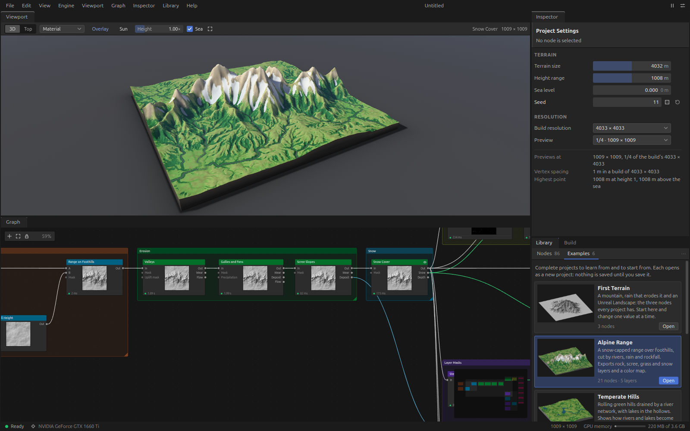

# Orogen

Orogen is a node-based terrain generator in the spirit of QuadSpinner Gaea. A terrain is a graph of nodes: a
mountain range, an erosion, a mask of the steep ground, a colour map. The graph is computed on the graphics card
with WebGPU compute shaders, shown in a 3D viewport while you edit, and built into the files that the Landscape
system of Unreal Engine 5.8 imports: a 16-bit heightmap up to 8129 × 8129, weight layers, companion textures and
a manifest with every number Unreal's import panel asks for.



It is a desktop application (Electron 44, React 19) and a command-line program (Node.js), both on one engine
written in TypeScript and WGSL. It is developed on Linux and is meant to run on Windows 11.

## What works, and what has not been verified

| | State |
| --- | --- |
| The engine, 86 nodes, the build with the Unreal manifest, the command-line program | Built. Tested on Linux on an NVIDIA GTX 1660 Ti, on Mesa's software adapter, on Windows' software Direct3D 12 adapter in CI, and on the target machine's RTX 3080 |
| The desktop application: graph, viewport, inspector, library with six example projects, build panel | Built. Tested on Linux in a window that is never shown, with input sent by tests. Used by hand once on Windows, on the target machine |
| The Windows build | Packed by CI, unsigned. Started and used on the target machine (Windows 11, RTX 3080) on 2026-10-15 |

**Verified once, on one machine**
([the first run](docs/user/first-run-on-windows.md#the-first-run-2026-10-15)): the Windows build on the RTX
3080, by hand, with builds at 4033 and 8129; the GPU and Electron test suites there; and the import into Unreal
Engine 5.8, where the acceptance test passed every check and a build of *Alpine Range* imported with its layers
([results](docs/user/unreal-import.md#65-results-on-unreal-engine-58)).

**Not yet verified:**

- **The fixes made after that run** for the UI tests that failed on Windows and for keyboard layouts: they have
  run on Linux only.
- **A visible window on Linux.** Every test drives a hidden window with synthesised input. Resizing the window is
  the one thing known to end the graphics process in such a hidden window; on Windows a visible one held.
- **Unreal beyond that run**: other versions of 5.8, and layers given on the New Landscape panel in a World
  Partition level ([import guide](docs/user/unreal-import.md#8-what-is-still-unverified)).
- **The Unreal plugin** (`unreal/OrogenBridge`): C++ source that has never been compiled.
- **The newest CI steps.** The start of the packaged application on a Windows runner, the unit tests on Windows
  and the first-start step of the Electron job were added without a run to show for them. Read the run.

[First run on Windows](docs/user/first-run-on-windows.md) is the checklist for the first session on a real
machine: what to try, in the order that finds the worst problems first, and what to send back.

## Get the Windows build

Every push to `main` packs the application for Windows in GitHub Actions.

1. Open the repository on GitHub, **Actions**, the workflow **ci**, and the latest run on `main` whose job
   `package-windows` is green. (You must be signed in with access to the repository.)
2. Under **Artifacts** at the foot of the run's page, download **`Orogen-windows-x64`**.
3. Unpack `Orogen-windows-x64.zip` into a folder of its own and start `Orogen.exe`. The build is unsigned:
   Windows says that it protected your PC; choose **More info**, then **Run anyway**.

With the GitHub command-line tool: `gh run download --repo <owner>/orogen --name Orogen-windows-x64 --dir Orogen`
(as its manual gives it; not run here).

| Artifact | Holds |
| --- | --- |
| `Orogen-windows-x64` | the application's folder: `Orogen.exe` and what it needs. **Take this one** |
| `Orogen-windows-x64-portable` | one file, `Orogen-<version>-win-x64-portable.exe`, which unpacks itself into the temporary folder at every start before anything appears |
| `launch-check-windows` | what CI saw when it started the build: whether the window loaded, and which graphics adapter the engine found |

The build holds the application and the user documentation. The command-line program and the tests need the
repository.

## Run from source

Node.js 24 or later (the project is developed with Node 26), Git, and a graphics card with a current driver.

**Windows** (PowerShell or Command Prompt):

```
git clone <address of the repository> orogen
cd orogen
npm ci
npm start
```

If PowerShell refuses `npm` because scripts are disabled, type `npm.cmd`. The repository's `.gitattributes`
keeps the line ends of its text files as they are stored, on every system; no Git setting is needed.

**Linux** (developed on Ubuntu, X11, NVIDIA with Vulkan):

```
git clone <address of the repository> orogen
cd orogen
npm ci
npm start
```

`npm start` builds the application into `dist/` and starts it. Nobody has run `npm start` to a visible window on
either system; the tests start the same build hidden.

| Command | Does |
| --- | --- |
| `npm start` | builds and starts the application |
| `npm run build` | builds the application into `dist/` |
| `npm run check` | the type check |
| `npm run test:unit` | the tests that need no graphics device |
| `npm run test:gpu` | the engine and every node on the graphics device |
| `npm run test:electron`, `npm run test:ui` | the built application, in windows that are never shown; run `npm run build` first |
| `npm run dist:win` | packs the application for Windows into `release/` (on Windows) |

On Linux the test scripts run inside a memory cap (`tools/guard`), and anything else that runs project code from
a shell is started the same way: `tools/guard node src/cli/main.ts probe`. A test that ran away once took the
whole desktop session with it.

## The example projects

Six projects are in [`examples/`](examples) and in the application's **Library** panel under **Examples**: First
Terrain (three nodes), Alpine Range, Temperate Hills, Volcanic Island, Desert Canyons and Cratered Highland.
Each opens as a new project; nothing is saved until you save it. Each also builds without a window:

```
node src/cli/main.ts build examples/alpine-range.orogen --out D:\Build\Alpine
```

[`docs/user/examples/ridge.orogen`](docs/user/examples/ridge.orogen) is the small project the documentation
builds and imports.

## The command-line program

```
node src/cli/main.ts probe                                   what Orogen sees of the graphics device, as JSON
node src/cli/main.ts render generate/mountain-range          draws one node to a PNG under test-output/
node src/cli/main.ts gallery                                 draws every node, with a page per category
node src/cli/main.ts build <project.orogen> --out <folder>   builds a project into the files Unreal imports
node src/cli/main.ts unreal-test --out <folder>              writes the acceptance pattern for Unreal Engine
```

`node src/cli/main.ts --help` lists the options; [the command-line page](docs/user/command-line.md) describes
each subcommand and its exit codes.

## Documentation

| | |
| --- | --- |
| [User guide](docs/user/README.md) | getting started, concepts, the application, the command line, every node, building, importing into Unreal Engine |
| [First run on Windows](docs/user/first-run-on-windows.md) | the checklist for the first session on a real machine |
| [Architecture](docs/ARCHITECTURE.md) | the map of the code, and the platform facts that were measured |
| [Contract](docs/contract) | what the engine, the runtime, the nodes, the export and the tests must do |

## When something goes wrong on the first run

Send these:

1. **The log file**, `%APPDATA%\orogen\logs\orogen.log` on Windows (`~/.config/orogen/logs/orogen.log` on
   Linux): errors of the application and of its interface, and every time one of its processes ended
   unexpectedly, the graphics process among them. It is written from the first thing that goes wrong, so it may
   not be there.
2. **A screenshot of the whole window** (`Win+Shift+S`), with the status bar at its foot: it names the state of
   the graphics device, the adapter, what is being computed, and the graphics memory in use.
3. **The text of the status bar's left end** if it is not `Ready` and the name of your card. `Graphics device
   failed` shows its reason when the pointer rests on it, and has a **Retry** button: say whether Retry helped.
4. **The application's messages**: **View → Show Errors** opens *Errors and Messages*; select its text and
   copy it.
5. **The output of `node src/cli/main.ts probe`**, if the repository is checked out.
6. Windows' version, the graphics driver's version, the display's resolution and scaling.

If no window appears at all, or for Chromium's own log and the developer console, see
[First run on Windows](docs/user/first-run-on-windows.md#if-nothing-opens).

## Repository

| Folder | Holds |
| --- | --- |
| `src/core` | the engine: devices, the texture pool, the evaluator, the session, every node |
| `src/export` | the build: planning, encoders, the manifest, the output folder |
| `src/app`, `src/viewport`, `src/platform` | the application: panels, the 3D renderer, Electron's main process and workers |
| `src/cli` | the command-line program |
| `tests` | unit, GPU, Electron and UI tests |
| `examples` | the six example projects |
| `unreal/OrogenBridge` | the experimental Unreal editor plugin (never compiled) |
| `build` | the application icon and the script that makes it from `icon.svg` |
| `.github` | CI, and the launch check it runs on the packaged application |

Private; not licensed for redistribution.
